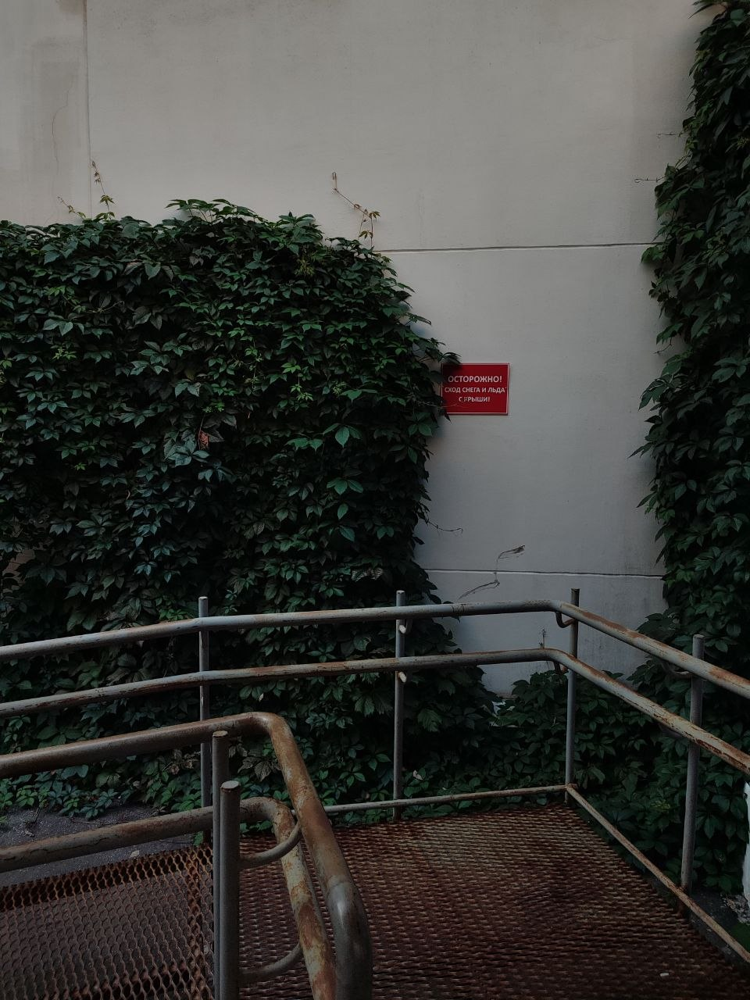
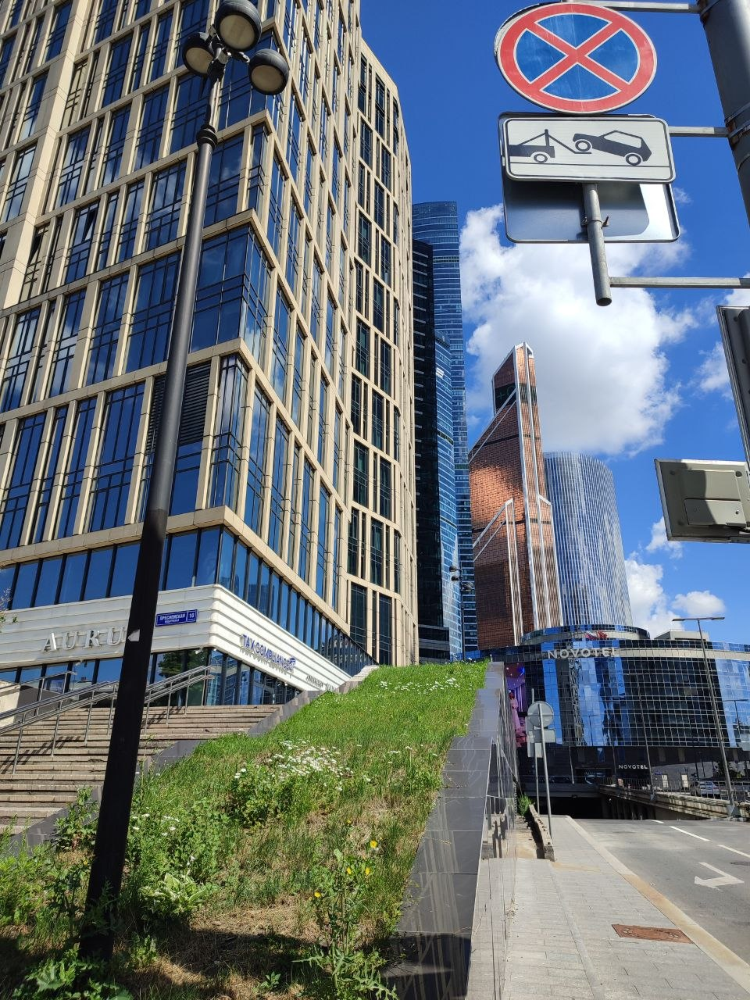

# Лабораторная работа №1

ФИО:  Давыдова Виктория Александровна

Группа: 6405-010302D

Научный руководитель: Никоноров Артем Владимирович

Предполагаемая тема диплома: "Разработка алгоритмов тестирования студентов на основе языковых моделей с дополненной генерацией"

"Я знаю, что ничего не знаю."

© ПМИ.

# Лабораторная работа №2

Предметная область: социальная сеть

Название: O2

Концепция: социальная сеть О2 - это глоток свежего воздуха в мире, где человек не может сделать ни шага без шанса остаться незамеченным. О2 собирает минимум данных [1], не хранит пароли и переписки. Вы полостью защищены от постороннего вмешательства в вашу личную жизнь.

[1]: в рамках лабораторной работы необходмо вводить и логин, и пароль, и почту.

На данный момент социальная сеть включает в себя экраны:

регистрации

авторизации

ленты новостей

информации о друзьях

профиль пользователя

мессенджер

## Экран регистрации 
представляет из себя форму, состоящую из полей ввода имени пользователя, почты и пароля. По кнопке "Зарегистрироваться" можно перейти на главный экран - экран новостной ленты. Под кнопкой расположена ссылка "Войти" на авторизацию в случае, если у пользователя уже есть аккаунт в социальной сети.

## Экран авторизации
представляет из себя форму, состоящую из полей ввода имени пользователя и пароля. По кнопке "Войти" можно перейти на главный экран - экран новостной ленты. Под кнопкой расположена ссылка "Зарегистрироваться" на регистрацию в случае, если у пользователя еще нет аккаунта в социальной сети.

## Главный экран - экран новостной ленты
состоит из двух частей: боковой панели и основного пространства. На боковой панели расположены ссылки для переключения между экранами. На данный момент реализовано переключение между экранами "Лента" и "Друзья". В основной части расположены текстовые посты с аватарками пользователей, логинами и основным смысловым содержанием.

## Друзья
Экран включает в себя таблицу с пользователями, с которыми мы подружились на данный момент в рамках социальной сети, а также некоторую информацию о них: имя, город, статус активен или неактивен.

## Планы
В дальнейшем будут дописаны оставшиеся экраны, а также реализован переход между ними.

# Лабораторная работа №3

## Цель лабораторной работы: 
изучение основ JavaScript.

## Задание на программирование: 
написать набор функций на языке JavaScript, реализующих требуемый функционал, и загрузить проект в репозиторий.
